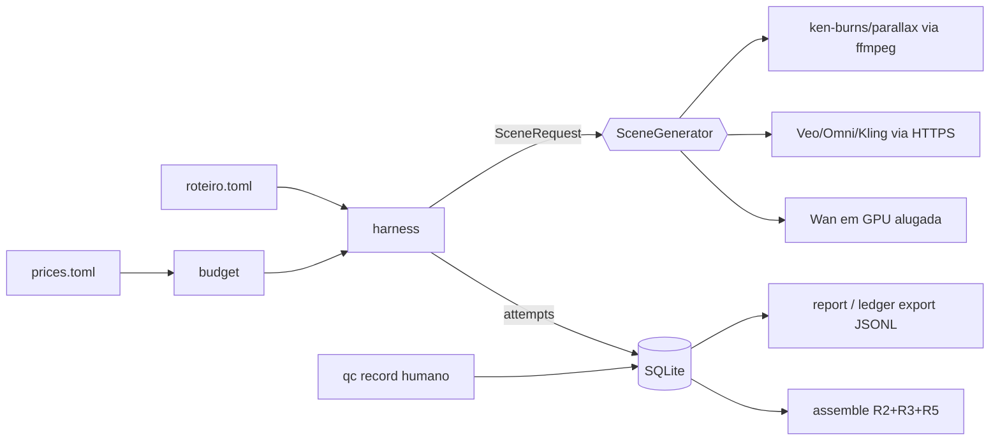

# Spec · Harness de comparação da Fase 0

Status: proposta · 2026-10-31 · autor: verion-architect · decisão: ADR-005 (`docs/memory/DECISIONS.md`)

## 1. Objetivo e fora de escopo

**Objetivo.** Rodar o mesmo roteiro de 12 cenas (uma foto por cena) por vários métodos e medir, por cena e
por tentativa: custo em R$, número de tentativas, tempo de parede e veredito de QC. Ao final, emitir uma
tabela comparativa por método que responda qual método entrega cenas aprovadas com o menor custo.

Métodos (id estável usado no banco, na CLI e no JSON de QC):
`ken-burns`, `parallax-2.5d` (locais, custo zero), `veo-3.1-fast`, `gemini-omni-1.1-flash`, `kling-3.0`,
`wan-2.2-5b` (pagos) e `fake` (só testes).

**Fora de escopo:** UI, fila, workers, paralelismo (as cenas rodam em sequência), Postgres, upload para
nuvem, roteiro gerado por LLM, QC automático que aprove sozinho (métricas servem só para triagem),
trilha musical (R4 só entra se houver arquivo com licença registrada), escolha de preços (vêm do plano do
produto e entram em `config/prices.toml`).

## 2. Estrutura do pacote

```
pyproject.toml                  # uv, Python >=3.12, script `verion = "verion.cli:main"`
config/prices.example.toml      # modelo; o real (config/prices.toml) é preenchido pelo verion-product
examples/roteiro.example.toml   # roteiro de 12 cenas de exemplo (fotos fictícias)
src/verion/
  cli.py  config.py  script.py  harness.py  report.py  budget.py
  ledger/   db.py  repo.py  schema.sql
  providers/ base.py  registry.py  fake.py  veo.py  gemini_omni.py  kling.py  wan.py
  local/    ffmpeg.py  ken_burns.py  parallax.py  depth.py  assembly.py  qc_frames.py
tests/      conftest.py  test_*.py  providers/  local/  acceptance/
data/       (gitignored) verion.db, runs/<run_id>/<method>/s<NN>_t<N>.mp4, qc/<attempt_id>/
docs/engineering/evidence/fase0/  # export JSONL do ledger (versionado; sobrevive à sessão efêmera)
```

`registry.py` mapeia id do método → `"modulo:Classe"` e importa sob demanda, então nenhuma tarefa de
adaptador precisa editar um arquivo comum. Pytest roda com `--import-mode=importlib` (sem `__init__.py` em `tests/`).

## 3. Interfaces

### 3.1 Contrato do adaptador (`src/verion/providers/base.py`)

```python
Camera = Literal["push-in", "pull-out", "pan-left", "pan-right", "static"]
UnitKind = Literal["video_seconds", "gpu_seconds", "credits", "none"]

@dataclass(frozen=True)
class Scene:
    index: int                 # 1..12
    photo: Path
    room: str                  # "fachada", "sala"...
    camera: Camera
    duration_s: float          # alvo, 3.0..10.0; o adaptador arredonda para o valor suportado e informa o real
    prompt: str                # só movimento de câmera; nunca descreve objeto que não está na foto
    negative_prompt: str = ""

@dataclass(frozen=True)
class SceneRequest:
    scene: Scene
    run_id: int
    attempt_no: int            # 1..3
    out_path: Path
    seed: int | None = None

@dataclass(frozen=True)
class CostEstimate:
    units: float
    unit_kind: UnitKind
    cost_brl: float

@dataclass(frozen=True)
class SceneResult:
    clip_path: Path
    duration_s: float
    width: int
    height: int
    fps: float
    units: float
    unit_kind: UnitKind
    cost_brl: float
    cost_is_estimate: bool     # True se o provedor não devolve o consumo faturado
    provider_job_id: str | None = None
    meta: dict[str, str] = field(default_factory=dict)

class ProviderError(Exception):
    def __init__(self, msg: str, *, transient: bool, billed_units: float = 0.0,
                 provider_job_id: str | None = None) -> None: ...

@runtime_checkable
class SceneGenerator(Protocol):
    method: str                # "veo-3.1-fast"
    provider: str              # "google" | "kling" | "gpu-rental" | "local"
    model: str                 # id exato do modelo no provedor
    paid: bool
    def estimate(self, req: SceneRequest) -> CostEstimate: ...
    def generate(self, req: SceneRequest) -> SceneResult: ...   # bloqueante; polling e timeout internos
```

Construtor de todo adaptador: `__init__(self, prices: PriceTable, client: object | None = None)`.
O `client` permite injetar um mock; sem ele, o adaptador cria o cliente real lendo a chave do ambiente
(`GEMINI_API_KEY`, `KLING_*`, `WAN_*`). Retries com backoff só em erro transitório **antes** de o job ser
aceito (helper em `base.py`; sem `tenacity`). Depois de aceito, falha vira `ProviderError(billed_units=...)`.
`registry.create(method: str, prices: PriceTable, client: object | None = None) -> SceneGenerator`.

### 3.2 Configuração, roteiro, orçamento e harness

```python
# config.py
class PriceMissing(Exception): ...
@dataclass(frozen=True)
class PriceTable:                      # carregada de config/prices.toml (tomllib)
    fx_usd_brl: float
    methods: dict[str, MethodPrice]    # MethodPrice(unit_kind, price_per_unit, currency: "USD"|"BRL")
    def cost_brl(self, method: str, units: float) -> float: ...  # PriceMissing se ausente ou 0 num método pago
def load_prices(path: Path) -> PriceTable: ...

# script.py — roteiro TOML: property_id + exatamente 12 [[scenes]] com os campos de Scene
@dataclass(frozen=True)
class Script: property_id: str; path: Path; sha256: str; scenes: tuple[Scene, ...]
def load_script(path: Path) -> Script: ...   # ScriptError: != 12 cenas, índice fora de 1..12, foto ausente

# budget.py
class PaidCallBlocked(Exception): ...      # método pago sem --allow-paid
class BudgetExceeded(Exception): ...       # gasto + estimativa > autorizado
def check(conn, gen: SceneGenerator, est: CostEstimate, *, allow_paid: bool) -> None: ...

# harness.py
@dataclass(frozen=True)
class RunSummary: run_id: int; attempted: int; ok: int; errors: int; cost_brl: float
def run_scenes(conn, script: Script, gen: SceneGenerator, *, allow_paid: bool,
               scenes: Sequence[int] | None = None, run_id: int | None = None,
               data_dir: Path = Path("data"), clock: Callable[[], float] = time.monotonic) -> RunSummary: ...
```

Fluxo por cena em `run_scenes`: `next_attempt_no` → `gen.estimate` → `budget.check` → `generate`
cronometrado com `clock` → `record_attempt` (ok ou erro, com custo faturado). Uma recusa do orçamento
interrompe o run antes de qualquer chamada. Regras de tentativa: no máximo 3 por cena; erro conta como
tentativa; cena com veredito final (`aprovada`/`rejeitada`) fica encerrada; tentativa `ok` sem QC bloqueia
nova tentativa (evita pagar duas vezes antes de alguém olhar).

### 3.3 Mídia local (interfaces que a CLI consome)

```python
# local/ffmpeg.py
@dataclass(frozen=True)
class Probe: codec: str; width: int; height: int; pix_fmt: str; fps: str; duration_s: float
def run(args: list[str]) -> None: ...           # subprocess sem shell; FfmpegError com stderr
def probe(path: Path) -> Probe: ...
def is_delivery_format(p: Probe) -> bool: ...   # h264, 1920x1080, yuv420p, 30/1
# local/ken_burns.py: KenBurnsAdapter (receita R1; camera → expressão do zoompan; zoom máx 1,06)
# local/parallax.py:  ParallaxAdapter (deslocamento por camada de profundidade, amplitude ≤ 2% da largura)
# local/depth.py
class DepthEstimator(Protocol):
    def depth(self, photo: Path) -> Path: ...   # PNG 16 bits em escala de cinza, mesma resolução da foto
class DepthFromFile: ...                        # lê <foto>.depth.png pré-computado (usado nos testes)
# local/assembly.py: receitas R2 + R3 (+ R5 se demo)
def assemble(clips: Sequence[Path], out: Path, *, transition_s: float = 0.5, demo: bool = False) -> Path: ...
# local/qc_frames.py: receita R6
def extract(clip: Path, out_dir: Path) -> tuple[list[Path], Path]: ...   # (quadros 1/s, folha de contato)
```

### 3.4 Esquema SQLite (`ledger/schema.sql`, `PRAGMA user_version = 1`, `foreign_keys = ON`)

| Tabela | Colunas |
|---|---|
| `runs` | `id` INTEGER PK · `property_id` TEXT · `method` TEXT · `script_path` TEXT · `script_sha256` TEXT · `started_at` TEXT (ISO 8601 UTC) · `finished_at` TEXT NULL · `notes` TEXT |
| `attempts` | `id` INTEGER PK · `run_id` FK→runs · `scene_index` INTEGER CHECK 1..12 · `attempt_no` INTEGER CHECK 1..3 · `method` · `provider` · `model` TEXT · `status` TEXT CHECK (`ok`,`error`) · `clip_path` TEXT NULL · `duration_s` REAL · `wall_time_s` REAL · `units` REAL · `unit_kind` TEXT · `cost_brl` REAL NOT NULL · `cost_is_estimate` INTEGER (0/1) · `provider_job_id` TEXT NULL · `error` TEXT NULL · `created_at` TEXT · UNIQUE(`run_id`,`scene_index`,`attempt_no`) |
| `qc_reviews` | `id` INTEGER PK · `attempt_id` FK→attempts UNIQUE · `verdict` TEXT CHECK (`aprovada`,`refazer`,`rejeitada`) · `reviewer` TEXT CHECK (`humano`,`agente`) · `defects_json` TEXT (lista `{tipo 1..7, segundo, nota}`) · `reviewed_at` TEXT |
| `authorizations` | `id` INTEGER PK · `amount_brl` REAL CHECK > 0 · `reference` TEXT NOT NULL (ex.: "STATE.md 2026-11-03") · `created_at` TEXT |

`ledger/repo.py`: `connect(path) -> Connection` (aplica o esquema), `create_run`, `finish_run`,
`next_attempt_no(conn, run_id, scene_index) -> int` (`AttemptLimit`/`AwaitingQC`/`SceneClosed`),
`record_attempt(conn, row: AttemptRow) -> int`, `record_qc(conn, attempt_id, verdict, reviewer, defects) -> int`
(rejeita defeito com tipo fora de 1..7 e `aprovada` com defeito bloqueante), `spent_brl(conn)`,
`authorized_brl(conn)`, `add_authorization(conn, amount_brl, reference)`, `export_jsonl(conn, out_dir) -> list[Path]`.
Migração reversível: `schema.sql` cria; `drop_all(conn)` desfaz (só nos testes). Sem ORM.

## 4. CLI (`verion`, argparse)

| Comando | Efeito |
|---|---|
| `verion db init` | cria `data/verion.db` (ou `$VERION_DB`) |
| `verion budget authorize --brl 350 --ref "STATE.md AAAA-MM-DD"` | registra autorização; só o supervisor roda, após consentimento do usuário em `STATE.md` |
| `verion budget show` | autorizado, gasto, saldo |
| `verion run --script R.toml --method M [--scenes 1,3] [--run ID] [--allow-paid] [--dry-run]` | gera as cenas; `--dry-run` só imprime a estimativa por cena e o total |
| `verion qc frames --attempt ID` | R6 em `data/qc/<ID>/` |
| `verion qc record --attempt ID --verdict V --reviewer humano [--defect "2:3.0:nota"]...` | grava o veredito |
| `verion assemble --run ID [--fallback-run ID] [--demo] --out F.mp4` | junta só cenas aprovadas, em ordem; lacunas vêm do run de fallback (ex.: ken-burns) ou são omitidas e listadas |
| `verion report [--format md\|csv]` | por método: aprovadas/12, tentativas, tentativas por aprovada, custo total, custo por aprovada, tempo médio, rejeições por tipo de defeito |
| `verion ledger export` | JSONL de runs/attempts/qc/authorizations em `docs/engineering/evidence/fase0/`, um registro por cena no formato da skill `verion-fidelity-qc` |

Códigos de saída: 0 ok · 2 uso inválido · 3 `PaidCallBlocked`/`BudgetExceeded`/`PriceMissing` · 4 erro de provedor.

## 5. Plano de entrega

Ordem: T1 → T2 → {T3, T5, T6, T7, T8, T9} em paralelo → T4 → T12. T10 e T11 estão bloqueadas por decisão.
Toda tarefa: TDD, sem rede, sem chamada paga e sem `GEMINI_API_KEY` no ambiente de teste.
Arquivos fora da própria lista: parar e pedir ao supervisor. Só o supervisor edita `pyproject.toml` depois de T1.
Na tabela, caminhos que não começam com `tests/`, `config/`, `examples/`, `pyproject.toml` ou `.gitignore` são relativos a `src/verion/`.

| # | Agente | Arquivos exclusivos | Pronto quando |
|---|---|---|---|
| T1 | backend | `pyproject.toml`, `.gitignore` (adiciona `data/`), `src/verion/__init__.py`, `config.py`, `budget.py`, `ledger/{__init__.py,db.py,repo.py,schema.sql}`, `config/prices.example.toml`, `tests/conftest.py`, `tests/test_config.py`, `tests/test_ledger.py`, `tests/test_budget.py` | `uv run pytest tests/test_config.py tests/test_ledger.py tests/test_budget.py` verde; os testes cobrem: 4ª tentativa → `AttemptLimit`; `ok` sem QC → `AwaitingQC`; gasto 349 + estimativa 2 com autorização 350 → `BudgetExceeded`; método pago sem `allow_paid` → `PaidCallBlocked`; preço 0 → `PriceMissing`; tipo de defeito 8 rejeitado |
| T2 | ai-engineer | `providers/{__init__.py,base.py,registry.py,fake.py}`, `tests/providers/test_contract.py` | `isinstance(FakeAdapter(...), SceneGenerator)`; o teste de contrato roda sobre todo método do registry cujo módulo importa (os ausentes são pulados com `importorskip`); o `fake` simula sucesso, erro transitório e erro faturado |
| T3 | backend | `script.py`, `harness.py`, `examples/roteiro.example.toml`, `tests/test_script.py`, `tests/test_harness.py` | com o `fake` e um relógio falso: 12 cenas → 12 tentativas com `wall_time_s` exato; erro faturado grava custo > 0 e `status=error`; recusa do orçamento não cria tentativa; roteiro com 11 cenas → `ScriptError` |
| T4 | backend | `cli.py`, `report.py`, `tests/test_cli.py`, `tests/test_report.py` | os 9 comandos da seção 4 com os códigos de saída; `report` sobre um banco semeado bate com valores calculados à mão; `ledger export` gera JSONL válido. Mídia é mockada nos testes |
| T5 | media | `local/{__init__.py,ffmpeg.py,ken_burns.py}`, `tests/local/test_ffmpeg.py`, `tests/local/test_ken_burns.py` | para cada `camera`, a cena de 5 s sobre uma foto sintética (lavfi `testsrc2`, gerada no teste) tem `is_delivery_format` verdadeiro e duração 5,0 ± 0,05 s |
| T6 | media | `local/{parallax.py,depth.py}`, `tests/local/test_parallax.py` | com o mapa de profundidade sintético (gradiente): saída em formato de entrega; SSIM do 1º quadro contra a foto escalada ≥ 0,95 (filtro `ssim` do ffmpeg); licença do modelo de profundidade real verificada e citada no retorno, sem baixar o modelo nos testes |
| T7 | media | `local/{assembly.py,qc_frames.py}`, `tests/local/test_assembly.py`, `tests/local/test_qc_frames.py` | 3 clipes de 5 s com resoluções diferentes → montagem de 14,0 ± 0,1 s em formato de entrega; `demo=True` aplica R5; `extract` devolve 1 quadro/s e a folha de contato |
| T8 | ai-engineer | `providers/veo.py`, `tests/providers/test_veo.py` | contrato passa; com cliente mock: request leva foto + prompt + duração suportada; polling até concluir; timeout → `ProviderError(transient=True)`; custo = `PriceTable` × segundos gerados. Assinaturas do SDK conferidas na doc oficial e citadas no retorno |
| T9 | ai-engineer | `providers/gemini_omni.py`, `tests/providers/test_gemini_omni.py` | idem T8, usando Files API + Interactions API (`google-genai>=2.19.0`, first-frame, 1080p, duração inteira 3..10) |
| T10 | ai-engineer | `providers/kling.py`, `tests/providers/test_kling.py` | **bloqueada**: o supervisor decide o acesso (API oficial ou agregador). Depois, critério igual ao de T8 |
| T11 | ai-engineer | `providers/wan.py`, `tests/providers/test_wan.py` | **bloqueada**: o supervisor escolhe o provedor de GPU e o modo de serviço. Custo em `gpu_seconds`, incluindo boot e tempo ocioso |
| T12 | qa | `tests/acceptance/conftest.py`, `tests/acceptance/test_fase0_e2e.py` | via CLI (subprocess) com roteiro sintético de 12 cenas: `ken-burns` completo; `fake` pago bloqueado sem `--allow-paid` (código 3); QC registrado; `assemble` com fallback; `report` lista os 2 métodos; `pytest` inteiro < 120 s em CPU |

Dependências: núcleo só com stdlib (argparse, sqlite3, tomllib, subprocess) + `ffmpeg`/`ffprobe` do
sistema. `numpy` (BSD-3) e `Pillow` (licença HPND) entram em T1 para o parallax: são maduras, gratuitas e sem serviço. Extra
`gemini = ["google-genai>=2.19.0"]` (Apache-2.0) entra em T1. Dev: `pytest` (MIT). O modelo de profundidade real
(candidato: Depth Anything V2 Small; licença **a verificar** no model card, porque variantes maiores podem
ser não comerciais) e o `torch` ficam num extra `depth`, que o supervisor adiciona depois de T6.



## 6. Riscos técnicos abertos

1. **Sessão efêmera.** `data/` (banco e vídeos) se perde. Mitigação: `verion ledger export` e commit depois de
   todo run pago. Os vídeos precisam de um destino persistente: **decisão do supervisor**.
2. **Durações e resoluções por provedor.** Cada provedor aceita durações discretas próprias. O adaptador
   arredonda para cima e a montagem corta. Isso altera o custo e precisa aparecer em `duration_s` e `units`.
3. **Custo real ≠ estimado.** Quando a API não devolve o consumo, `cost_is_estimate=1`. Conciliar com a fatura do
   painel ao fim da Fase 0.
4. **Kling e Wan sem rota de acesso definida** (T10, T11). O custo de GPU alugada inclui boot, download de pesos e ociosidade;
   é o método mais sujeito a estourar a estimativa.
5. **Proxy da sessão em nuvem** pode bloquear os domínios das APIs (ver `STATE.md`). É preciso liberá-los antes do 1º run pago.
6. **Enum de métodos da skill `verion-fidelity-qc`** não inclui `gemini-omni-1.1-flash`. A skill precisa ser
   atualizada (fora dos arquivos desta tarefa).
7. **Fotos de imóveis reais**: ficam só em `data/` (gitignored). Os caminhos no export JSONL não podem conter nome
   do proprietário nem endereço; usar `property_id` neutro (ex.: `casa-01`).
8. **Parallax 2,5D** pode deformar bordas (defeito tipo 4). Por isso a amplitude é limitada a 2% e o QC humano continua obrigatório.
