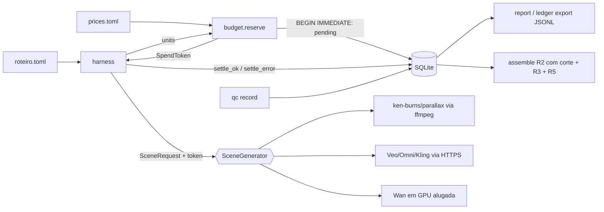

# Spec · Harness de comparação da Fase 0

Status: proposta, rodada 2 · 2026-11-01 · autor: verion-architect · decisão: ADR-005 (`docs/memory/DECISIONS.md`)

## 1. Objetivo e fora de escopo

**Objetivo.** Rodar o mesmo roteiro de 12 cenas (uma foto por cena) por vários métodos e medir, por cena e por
tentativa, custo em R$, tentativas, tempo de parede e veredito de QC; a tabela final por método mostra qual entrega
cenas aprovadas com o menor custo. Métodos (id estável no banco, na CLI e no JSONL): `ken-burns` e `parallax-2.5d`
(locais, grátis); `veo-3.1-fast`, `gemini-omni-1.1-flash`, `kling-3.0`, `wan-2.2-5b` (pagos); `fake` (pago fictício,
só testes).

**Fora de escopo:** UI, fila, workers, paralelismo, Postgres, nuvem, roteiro por LLM, QC automático que aprove, trilha
(R4) e escolha de preços (o `verion-product` preenche `config/prices.toml` com a fonte de cada preço).

## 2. Estrutura do pacote

```
pyproject.toml   config/prices.example.toml   examples/roteiro.example.toml
src/verion/  __init__.py errors.py config.py budget.py script.py harness.py report.py cli.py
  ledger/    __init__.py repo.py schema.sql export.py
  providers/ __init__.py base.py registry.py contract.py fake.py veo.py gemini_omni.py kling.py wan.py
  local/     __init__.py ffmpeg.py ken_burns.py parallax.py depth.py assembly.py qc_frames.py
tests/  conftest.py test_*.py providers/ local/{conftest.py,...} acceptance/{conftest.py,...}
$VERION_DATA_DIR (padrão ./data, gitignored): verion.db  runs/<run_id>/<method>/sNN_tN.mp4  qc/<attempt_id>/
docs/engineering/evidence/fase0/   export JSONL versionado (a sessão é efêmera)
```

Pytest roda com `--import-mode=importlib`, sem `__init__.py` em `tests/`. Nos blocos de código abaixo, toda classe com
campos é `@dataclass(frozen=True)`.

## 3. Interfaces

### 3.1 Erros e códigos de saída (`errors.py`)

Toda exceção de domínio herda de `VerionError` e tem um `exit_code`. `cli.main` captura `VerionError`, imprime em
stderr e devolve o `exit_code`. Qualquer outra exceção é bug: sai com traceback e código 1.

| Código | Base | Subclasses |
|---|---|---|
| 0 | n/a | sucesso; inclui o run com cenas puladas, desde que ao menos uma cena tenha sido tentada |
| 2 | `InputError` | `ConfigError`, `SchemaMismatch`, `ScriptError`, `UnknownMethod`, `MethodUnavailable`, `InvalidVerdict`, `AuthorizationRefused`, `DepthMissing`; erros do argparse |
| 3 | `SpendBlocked` | `PaidCallBlocked`, `BudgetExceeded`, `PriceMissing`, `EstimateInvalid`, `TokenInvalid` |
| 4 | `ProviderError` | `__init__(msg, *, transient: bool, billed_units: float = 0.0, provider_job_id: str \| None = None)` |
| 5 | `AttemptRuleError` | `AwaitingQC`, `SceneClosed` (inclui o limite de 3), `PendingAttempt`; só sai com 5 se nenhuma cena pedida foi tentada |
| 6 | `FfmpegError` | `stderr: str` |

### 3.2 Configuração e preços (`config.py`)

```python
UnitKind = Literal["video_seconds", "gpu_seconds", "credits", "none"]   # definido aqui (T1); base.py importa de config
FREE_METHODS: Final = frozenset({"ken-burns", "parallax-2.5d"})   # mudar exige ADR
class MethodPrice: unit_kind: UnitKind; price_per_unit: float; currency: Literal["USD", "BRL"]; source: str
class PriceTable:
    fx_usd_brl: float; methods: Mapping[str, MethodPrice]
    def is_paid(self, method: str) -> bool: ...                 # False só para FREE_METHODS
    def cost_brl(self, method: str, units: float) -> float: ... # 0.0 se grátis; PriceMissing se pago e ausente
def load_prices(path: Path) -> PriceTable: ...  # ConfigError: arquivo ausente, pago <= 0, grátis != 0, fx <= 0
```

O adaptador não declara mais `paid`: todo método é pago, a menos que esteja em `FREE_METHODS`. Só o `cli.py` lê o
ambiente e repassa os valores por argumento. As exceções são o cliente real dos pagos e o `FakeClient`.

| Variável | Padrão | Uso |
|---|---|---|
| `VERION_DATA_DIR` | `./data` | `verion.db`, `runs/`, `qc/` |
| `VERION_PRICES` | `config/prices.toml` | Tabela de preços. Ausente: `ConfigError` |
| `VERION_FAKE_MODE` | `ok` | Resultados do `fake`, separados por vírgula e usados em ordem; o último se repete. `ok`; `transient` (falha antes do aceite, sem faturamento); `billed_error` (aceito e faturado; `billed_units` = duração) |

### 3.3 Orçamento (`budget.py`): reserva, token e liquidação

```python
class SpendToken:            # só reserve() cria (exige o selo privado budget._SEAL); uso único
    # EXCEÇÃO à regra frozen: classe comum (não dataclass congelada); guarda `_conn` e a flag mutável `_used`
    attempt_id: int; attempt_no: int; method: str; reserved_brl: float
    def consume(self, method: str) -> None: ...      # TokenInvalid: sem selo, já usado, outro método, linha não-pending
    def job_accepted(self, job_id: str) -> None: ... # grava provider_job_id na linha pending (autocommit)
def reserve(conn, prices: PriceTable, *, run_id: int, scene_index: int, target_s: float, method: str,
            provider: str, model: str, units: float, unit_kind: UnitKind, allow_paid: bool) -> SpendToken: ...
def settle_ok(conn, token, *, units: float, cost_is_estimate: bool, clip_path: Path, duration_s: float,
              wall_time_s: float, provider_job_id: str | None) -> AttemptRow: ...
def settle_error(conn, token, *, billed_units: float, error: str, wall_time_s: float,
                 provider_job_id: str | None) -> AttemptRow: ...
```

**`reserve`, em ordem:** (1) método pago (`prices.is_paid`) sem `allow_paid` → `PaidCallBlocked`, nada gravado; (2)
`cost = prices.cost_brl(method, units)`; `unit_kind` divergente da tabela ou, em pago, `units <= 0` ou `cost <= 0` →
`EstimateInvalid` (o adaptador informa só unidades, nunca custo); (3) `BEGIN IMMEDIATE` (serializa processos
concorrentes) → `next_attempt_no` → se pago e `authorized_brl − spent_brl < cost`, `BudgetExceeded` e rollback →
`insert_pending(..., reserved_brl=cost)` → `COMMIT`.

**Liquidação.** `settle_ok` grava o custo real; `settle_error` grava `max(cost_brl(billed_units), reserved_brl)`:
**toda exceção mantém a reserva como custo mínimo**. Se o processo morrer antes, a linha fica `pending` com `cost_brl
= reserved_brl`, já somada ao gasto, e a cena fica em `PendingAttempt` até `verion ledger settle`, que só aceita custo
≥ reserva. Invariante: nenhum comando reduz o gasto registrado de tentativa que falhou.

**Autorização.** `verion budget authorize` exige `sys.stdin.isatty()` e a digitação exata de `AUTORIZO R$ <valor com 2
casas e vírgula>`; sem TTY → `AuthorizationRefused`, nada gravado. Verificado em 2026-11-01: o Bash dos agentes não
tem TTY (`os.isatty(0)` é False, `/dev/tty` inexistente). Limite declarado: é atrito contra ação acidental, não
fronteira de segurança (um agente pode emular TTY ou gravar no SQLite). As barreiras reais são (a) a chave de API, que
só o usuário põe no ambiente depois de autorizar, (b) uma regra `deny` de permissão para o comando (pendência do
supervisor) e (c) o teste AST da T1, que proíbe `add_authorization` em `src/verion/**` fora de `cli.py` e `providers/contract.py` (testes podem semear autorização via `repo`).

### 3.4 Contrato do adaptador (`providers/base.py`) e registry

```python
Camera = Literal["push-in", "pull-out", "pan-left", "pan-right", "static"]
from verion.config import UnitKind   # T1; não redefinir aqui
class Scene: index: int; photo: Path; room: str; camera: Camera; duration_s: float; prompt: str; negative_prompt: str = ""
#  duration_s: alvo de 3.0 a 10.0; prompt descreve só o movimento de câmera, nunca objeto ausente da foto
class SceneRequest: scene: Scene; run_id: int; attempt_no: int; out_path: Path; seed: int | None = None
class CostEstimate: units: float; unit_kind: UnitKind
class SceneResult:
    clip_path: Path; duration_s: float; width: int; height: int; fps: float
    units: float; unit_kind: UnitKind; cost_is_estimate: bool      # True se o provedor não devolve o consumo
    provider_job_id: str | None = None; meta: Mapping[str, str] = field(default_factory=dict)
@runtime_checkable
class SceneGenerator(Protocol):
    method: str; provider: str; model: str          # provider: "google" | "kling" | "gpu-rental" | "local" | "fake"
    def estimate(self, scene: Scene) -> CostEstimate: ...
    def generate(self, req: SceneRequest, token: SpendToken) -> SceneResult: ...   # bloqueante; polling interno
```

**Regras do adaptador.** Construtor `__init__(self, prices: PriceTable, client: object | None = None)`, sem ler chave
nem abrir conexão. `client` é a dependência externa injetável: SDK nos pagos (o real é criado de forma preguiçosa
dentro de `generate`), executor de ffmpeg no `ken-burns` (padrão `ffmpeg.run`), `DepthEstimator` no `parallax-2.5d`
(padrão `DepthFromFile()`) e `FakeClient` no `fake` (padrão `FakeClient.from_env()`). A **primeira instrução** de
`generate` é `token.consume(self.method)`; após o aceite do job, chama `token.job_accepted(job_id)`. Retry com backoff
só antes do aceite (`retry_before_accept` em `base.py`, sem `tenacity`); depois dele, falha vira
`ProviderError(billed_units=...)`.

**Registry.** `METHODS: Final[Mapping[str, str]]` com nomes fixos: `ken-burns` →
`verion.local.ken_burns:KenBurnsAdapter`; `parallax-2.5d` → `verion.local.parallax:ParallaxAdapter`; `veo-3.1-fast` →
`verion.providers.veo:VeoAdapter`; `gemini-omni-1.1-flash` → `verion.providers.gemini_omni:GeminiOmniAdapter`;
`kling-3.0` → `verion.providers.kling:KlingAdapter`; `wan-2.2-5b` → `verion.providers.wan:WanAdapter`; `fake` →
`verion.providers.fake:FakeAdapter`. `create(method, prices, client=None) -> SceneGenerator` importa sob demanda; id
desconhecido → `UnknownMethod`; módulo ou extra ausente → `MethodUnavailable`.

**Contrato** (`providers/contract.py`, sem pytest): `SpyClient` conta acessos e chamadas;
`assert_generator_contract(factory: Callable[[object | None], SceneGenerator], *, conn, prices, scene: Scene,
good_client: object, out_dir: Path) -> None` verifica (1) `isinstance(gen, SceneGenerator)` e `METHODS[gen.method]`
apontando para a classe; (2) `estimate` com o `unit_kind` da tabela e `units > 0` se pago; (3) token forjado, reusado
ou de outro método → `TokenInvalid` com `SpyClient.calls == 0`; (4) com `good_client` e token de `budget.reserve` (o
helper autoriza R$ 1.000 no `conn`), `SceneResult` com arquivo existente. Cada tarefa de adaptador chama o helper no
próprio teste, com o próprio mock: sem rede e sem mock alheio.

### 3.5 Roteiro e harness

```python
# script.py: TOML com property_id e exatamente 12 [[scenes]] com os campos de Scene
class Script: property_id: str; path: Path; sha256: str; scenes: tuple[Scene, ...]
def load_script(path: Path) -> Script: ...  # ScriptError: != 12 cenas, índice repetido ou fora de 1..12, foto ausente,
                                           # câmera inválida, duração fora de 3..10, property_id fora de ^[a-z0-9-]{1,32}$
# harness.py
class RunSummary:
    run_id: int; attempted: int; ok: int; errors: int; cost_brl: float
    skipped: Mapping[int, str]; stopped_by: str | None       # cena → motivo; erro que encerrou o run
def run_scenes(conn, script: Script, gen: SceneGenerator, prices: PriceTable, *, allow_paid: bool, data_dir: Path,
               scenes: Sequence[int] | None = None, run_id: int | None = None,
               clock: Callable[[], float] = time.monotonic) -> RunSummary: ...
```

**Fluxo por cena:** `estimate` → `budget.reserve` (`AttemptRuleError` põe a cena em `skipped` e segue; `SpendBlocked`
sobe sem criar linha) → `SceneRequest` com `token.attempt_no` → `generate` cronometrado por `clock` → `settle_ok`. Em
qualquer exceção, inclusive `KeyboardInterrupt`: `settle_error` com o `billed_units` do `ProviderError` (0 nas
demais), `finish_run` e relançamento. **O primeiro erro encerra o run**, para não queimar reservas em série. `--run
ID` com outro método → `InputError`.

### 3.6 Mídia local

```python
# local/ffmpeg.py
class Probe: codec: str; width: int; height: int; pix_fmt: str; fps: str; duration_s: float
def run(args: list[str]) -> None: ...          # subprocess sem shell; FfmpegError com stderr
def probe(path: Path) -> Probe: ...
def is_delivery_format(p: Probe) -> bool: ...  # h264, 1920x1080, yuv420p, 30/1
# local/ken_burns.py: KenBurnsAdapter (R1; câmera → expressão do zoompan; zoom máx. 1,06; unit_kind "none")
# local/depth.py
class DepthEstimator(Protocol):
    def depth(self, photo: Path) -> Path: ...  # PNG 16 bits em cinza, mesma resolução da foto
class DepthFromFile: ...                       # lê <foto>.depth.png; DepthMissing se ausente
# local/parallax.py: ParallaxAdapter (warp contínuo por pixel, ADR-008; amplitude ≤ 2% da largura; client = DepthEstimator)
# local/assembly.py: R2 com corte no alvo + R3 (+ R5 se demo)
class ClipSpec: path: Path; target_s: float
class AssemblyResult: out: Path; duration_s: float; short_clips: tuple[int, ...]  # clipes mais curtos que o alvo
def assemble(clips: Sequence[ClipSpec], out: Path, *, transition_s: float = 0.5, demo: bool = False) -> AssemblyResult: ...
# local/qc_frames.py: R6
def extract(clip: Path, out_dir: Path) -> QcFrames: ...  # QcFrames(frames a 1/s, sheet, last) — ADR-008
```

`assemble` corta cada clipe em `target_s` (com `-t` na R2) e nunca estica clipe curto: usa-o inteiro e o lista em
`short_clips`. Duração esperada: `Σ min(dur_i, target_i) − (n−1)·transition_s`.

### 3.7 Ledger (`ledger/schema.sql`, `PRAGMA user_version = 1`)

`repo.connect(path)` abre com `isolation_level=None` (transações explícitas), `foreign_keys=ON`, `journal_mode=WAL` e
`busy_timeout=5000`; aplica o esquema se `user_version = 0` e levanta `SchemaMismatch` se ≠ 1. Sem ORM;
`drop_all(conn)` só nos testes.

| Tabela | Colunas |
|---|---|
| `runs` | `id` PK · `property_id` · `method` · `script_path` · `script_sha256` · `started_at` (ISO 8601 UTC) · `finished_at` NULL · `notes` |
| `attempts` | `id` PK · `run_id` FK · `scene_index` CHECK 1..12 · `attempt_no` CHECK 1..3 · `method` · `provider` · `model` · `status` CHECK (`pending`,`ok`,`error`) · `target_s` REAL · `reserved_brl` REAL NOT NULL CHECK ≥ 0 · `cost_brl` REAL NOT NULL CHECK ≥ 0 · `cost_is_estimate` 0/1 · `units` REAL · `unit_kind` · `clip_path` NULL · `duration_s` NULL · `wall_time_s` NULL · `provider_job_id` NULL · `error` NULL · `created_at` · `finished_at` NULL · UNIQUE(`run_id`,`scene_index`,`attempt_no`) · CHECK(`status` <> 'error' OR `cost_brl` >= `reserved_brl`) |
| `qc_reviews` | `id` PK · `attempt_id` FK UNIQUE · `verdict` CHECK (`aprovada`,`refazer`,`rejeitada`) · `reviewer` CHECK (`humano`,`agente`) · `defects_json` · `reviewed_at` · CHECK(`verdict` <> 'aprovada' OR `reviewer` = 'humano') |
| `authorizations` | `id` PK · `amount_brl` CHECK > 0 · `reference` NOT NULL · `created_at` |
|---|---|

```python
AttemptStatus = Literal["pending", "ok", "error"]
SceneStatus = Literal["aberta", "pendente", "aguardando_qc", "aprovada", "rejeitada"]
class AttemptRow:
    id: int; run_id: int; scene_index: int; attempt_no: int; method: str; provider: str; model: str
    status: AttemptStatus; target_s: float; reserved_brl: float; cost_brl: float; cost_is_estimate: bool
    units: float; unit_kind: str; clip_path: str | None; duration_s: float | None; wall_time_s: float | None
    provider_job_id: str | None; error: str | None; created_at: str; finished_at: str | None
class RunRow:
    id: int; property_id: str; method: str; script_path: str; script_sha256: str
    started_at: str; finished_at: str | None; notes: str
class Defect: tipo: int | Literal["leve"]; segundo: float; nota: str    # 1..7 = bloqueante (skill verion-fidelity-qc)
class QcRow: id: int; attempt_id: int; verdict: str; reviewer: str; defects: tuple[Defect, ...]; reviewed_at: str

def create_run(conn, *, property_id: str, method: str, script_path: str, script_sha256: str, notes: str = "") -> int
def finish_run(conn, run_id: int) -> None
def get_run(conn, run_id: int) -> RunRow
def next_attempt_no(conn, run_id: int, scene_index: int) -> int     # regras abaixo, via scene_status
def insert_pending(conn, *, run_id, scene_index, attempt_no, target_s, method, provider, model,
                   units, unit_kind, reserved_brl) -> int           # só budget.reserve chama
def set_job_id(conn, attempt_id: int, job_id: str) -> None
def finish_attempt(conn, attempt_id: int, *, status: Literal["ok", "error"], cost_brl: float, cost_is_estimate: bool,
                   units: float, clip_path: str | None, duration_s: float | None, wall_time_s: float,
                   provider_job_id: str | None, error: str | None) -> AttemptRow     # só a partir de pending
def settle_pending(conn, attempt_id: int, *, cost_brl: float, note: str) -> AttemptRow  # vira error; custo >= reserva
def list_attempts(conn, *, run_id: int | None = None, method: str | None = None) -> list[AttemptRow]
def get_qc(conn, attempt_id: int) -> QcRow | None
def get_attempt(conn, attempt_id: int) -> AttemptRow | None      # ledger settle, qc record, qc frames
def list_runs(conn) -> list[RunRow]                                # report, export
def list_authorizations(conn) -> list[tuple[int, float, str, str]] # (id, amount_brl, reference, created_at); budget show
def scene_status(conn, run_id: int, scene_index: int) -> tuple[SceneStatus, str | None]   # (status, motivo)
def record_qc(conn, attempt_id: int, *, verdict: str, reviewer: str, defects: Sequence[Defect]) -> int
def spent_brl(conn) -> float          # SUM(cost_brl) de todas as tentativas; pending conta pela reserva
def authorized_brl(conn) -> float
def add_authorization(conn, amount_brl: float, reference: str) -> int   # só cli.py chama
```

**`scene_status`** (primeira regra que casar): revisão `aprovada` → `aprovada`; revisão `rejeitada` → `rejeitada`
(motivo: defeitos); tentativa `pending` → `pendente`; última tentativa `ok` sem QC → `aguardando_qc`; 3 tentativas →
`rejeitada` (motivo "limite de 3 tentativas"; cobre 3 erros e erros + `refazer`); senão `aberta`. `next_attempt_no`
levanta `SceneClosed`, `PendingAttempt` ou `AwaitingQC` conforme o status.

**`record_qc`** levanta `InvalidVerdict` se a tentativa não estiver `ok`; se `tipo` não for 1..7 nem `"leve"`; se
`aprovada` tiver bloqueante, mais de 1 leve ou revisor ≠ `humano`; se `refazer` não tiver bloqueante ou for na 3ª
tentativa; se `rejeitada` não tiver bloqueante.

### 3.8 Export JSONL (`ledger/export.py`)

`export_jsonl(conn, out_dir: Path) -> ExportResult(paths: list[Path], skipped_fake_runs: int)` reescreve `runs.jsonl`,
`attempts.jsonl`, `scenes.jsonl` e `authorizations.jsonl`, ordenados por `id` (diff estável); runs `fake` são
omitidos; caminhos de foto e de clipe nunca são exportados. `attempts.jsonl`, uma linha por tentativa: as chaves da
skill `verion-fidelity-qc` sempre presentes (`projeto` = `property_id`, `cena`, `metodo`, `tentativa`, `veredito`,
`defeitos`, `custo_brl`, `revisor`) mais as extensões `run_id`, `attempt_id`, `status`, `custo_estimado`,
`reservado_brl`, `unidades`, `tipo_unidade`, `duracao_s`, `tempo_s`, `erro`. Sem QC: `veredito` e `revisor` `null`,
`defeitos` `[]`. `metodo` sai literal (risco 6). `scenes.jsonl`, uma linha por run × cena: `projeto`, `metodo`,
`run_id`, `cena`, `status`, `motivo`, `tentativas`, `custo_brl`.

### 3.9 Relatório (`report.py`)

```python
class MethodReport:
    method: str; scenes_total: int; approved: int; rejected: int; open: int    # scenes_total = 12 × runs do método
    attempts: int; attempts_per_approved: float | None; cost_brl: float; cost_per_approved_brl: float | None
    mean_wall_time_s: float | None                                          # média só das tentativas ok
    blocking_defects: Mapping[int, int]                                     # tipo 1..7 → contagem em refazer/rejeitada
def build_report(conn) -> list[MethodReport]: ...                           # exclui fake; ordena por method
def render(rows: Sequence[MethodReport], fmt: Literal["md", "csv"]) -> str: ...
```

## 4. CLI (`verion`, argparse)

| Comando | Efeito |
|---|---|
| `verion db init` | Cria `$VERION_DATA_DIR/verion.db`. |
| `verion budget authorize --brl 350 --ref "STATE.md AAAA-MM-DD"` | Exige TTY e a frase de confirmação (3.3). |
| `verion budget show` | Mostra o autorizado, o gasto (incluindo reservas `pending`) e o saldo. |
| `verion run --script R.toml --method M [--scenes 1,3] [--run ID] [--allow-paid] [--dry-run]` | Gera as cenas. Com `--dry-run`, só mostra unidades e R$ por cena e o total, sem reservar. |
| `verion ledger settle --attempt ID [--cost-brl X] --note "..."` | Muda `pending` para `error`, com custo = max(X, reserva). |
| `verion qc frames --attempt ID` | Roda R6 em `$VERION_DATA_DIR/qc/<ID>/`. |
| `verion qc record --attempt ID --verdict V --reviewer humano\|agente [--defect "2:3.0:nota"] [--defect "leve:1.0:nota"]` | Grava o veredito, com as regras de 3.7. |
| `verion assemble --run ID [--fallback-run ID] [--demo] --out F.mp4` | Monta as cenas `aprovada` em ordem, via `ClipSpec(clip, target_s)`. As lacunas vêm do run de fallback; se não houver, são omitidas e listadas. |
| `verion report [--format md\|csv]` | Mostra o relatório de 3.9. |
| `verion ledger export [--out DIR]` | Exporta conforme 3.8. Padrão: `docs/engineering/evidence/fase0/`. |

## 5. Plano de entrega

**Ordem:** T1 → T2 → {T3, T5, T8, T9} → {T6, T7} → T4 → T12 (a T12 não espera T8/T9); T10 e T11 bloqueadas por
decisão. Toda tarefa: TDD, sem rede, sem chamada paga, sem chave de API; só importa de tarefas listadas em "Depende
de"; arquivo fora da lista → parar e pedir ao supervisor; depois da T1, só o supervisor edita `pyproject.toml`.
Caminhos sem prefixo `tests/`, `config/`, `examples/`, `pyproject.toml` ou `.gitignore` são relativos a `src/verion/`.

**Fixtures** (cada `conftest` tem um dono; os outros só consomem): `tests/conftest.py` (T1) — `prices` com preços
**fictícios** para os 5 pagos (`fake` = R$ 1,00/`video_seconds`), `conn` (banco em `tmp_path`), `authorize(brl)` e
`fake_clock` (com `.advance(s)`); `tests/local/conftest.py` (T5) — `synthetic_photo` (JPEG 4000×3000 via lavfi
`testsrc2`; falha com mensagem clara sem ffmpeg); `tests/acceptance/conftest.py` (T12).

| # | Agente | Depende de | Arquivos exclusivos | Pronto quando (testes) |
|---|---|---|---|---|
| T1 | backend | n/a | `pyproject.toml`, `.gitignore` (+`data/`), `__init__.py`, `errors.py`, `config.py`, `budget.py`, `ledger/{__init__.py,repo.py,schema.sql}`, `config/prices.example.toml`, `tests/conftest.py`, `tests/test_{config,ledger,budget,architecture}.py` | `uv run pytest` verde nesses arquivos, cobrindo: (a) pago sem `allow_paid` → `PaidCallBlocked` e 0 linhas; (b) gasto 349 + estimativa 2 com 350 autorizados → `BudgetExceeded` e 0 linhas; (c) `units=0` ou preço ausente → `EstimateInvalid`/`PriceMissing`; (d) duas conexões em threads com saldo para uma → exatamente 1 `pending`; (e) reserva não liquidada conta em `spent_brl` e gera `PendingAttempt`; (f) `settle_error` com faturado < reserva grava a reserva; `settle_pending` não reduz custo; (g) token forjado, reusado ou de outro método → `TokenInvalid`; (h) 3 erros → `rejeitada`, e a 4ª → `SceneClosed`; `ok` sem QC → `AwaitingQC`; (i) cada regra de `record_qc`; (j) `test_architecture` (AST): `_SEAL` e `insert_pending` só em `budget.py`/`ledger/repo.py`; escopo = `src/verion/**` (exclui `tests/`); `add_authorization` só em `cli.py` e `providers/contract.py` (allow-list explícita); todo método `generate` de classe `*Adapter` em `providers/*.py` e `local/{ken_burns,parallax}.py` recebe `token` e começa com `token.consume(self.method)` (o Protocol em `base.py` é isento) |
| T2 | ai-engineer | T1 | `providers/{__init__.py,base.py,registry.py,contract.py,fake.py}`, `tests/providers/test_fake.py`, `tests/providers/test_registry.py` | contrato passa no `fake`; `METHODS` = exatamente os 7 ids com os caminhos de 3.4; `create("x")` → `UnknownMethod`; módulo ausente → `MethodUnavailable`; os 3 modos de `VERION_FAKE_MODE` funcionam; o `fake` grava um arquivo de bytes, não MP4 |
| T3 | backend | T1, T2 | `script.py`, `harness.py`, `examples/roteiro.example.toml`, `examples/fotos/` (sintéticas), `tests/test_script.py`, `tests/test_harness.py` | com `fake` e `fake_clock`: 12 cenas → 12 `ok` com `wall_time_s` exato; `billed_error` → `error` com custo = max(faturado, reserva) e run encerrado; `BudgetExceeded` → 0 tentativas; `KeyboardInterrupt` em `generate` → `error` com a reserva e exceção relançada; `aguardando_qc` → `skipped`; cada caso de `ScriptError` |
| T5 | media | T1, T2 | `local/{__init__.py,ffmpeg.py,ken_burns.py}`, `tests/local/conftest.py`, `tests/local/test_ffmpeg.py`, `tests/local/test_ken_burns.py` | para cada `camera`, 5 s sobre `synthetic_photo` em formato de entrega, com 5,0 ± 0,05 s; contrato passa com o executor real do ffmpeg |
| T8 | ai-engineer | T2 | `providers/veo.py`, `tests/providers/test_veo.py` | contrato passa com mock; o request leva foto + prompt + duração suportada; polling até concluir; `job_accepted` recebe o id; timeout → `ProviderError(transient=True)`; `units` = segundos gerados |
| T9 | ai-engineer | T2 | `providers/gemini_omni.py`, `tests/providers/test_gemini_omni.py` | igual à T8, via Files API + Interactions API (first-frame, 1080p, duração inteira de 3 a 10) |
| T6 | media | T5 | `local/{parallax.py,depth.py}`, `tests/local/test_parallax.py` | com profundidade sintética (gradiente) via `DepthFromFile`: formato de entrega; SSIM do 1º quadro contra a foto escalada ≥ 0,95 (filtro `ssim`); sem `.depth.png` → `DepthMissing`; contrato passa |
| T7 | media | T5 | `local/{assembly.py,qc_frames.py}`, `tests/local/test_assembly.py`, `tests/local/test_qc_frames.py` | clipes de 8, 5 e 5 s com resoluções diferentes e alvo de 5 s → 14,0 ± 0,1 s em formato de entrega; clipe de 3 s com alvo de 5 s aparece em `short_clips`; `demo=True` aplica R5; `extract` devolve 1 quadro/s e a folha de contato |
| T4 | backend | T1, T2, T3, T5, T7 | `cli.py`, `report.py`, `ledger/export.py`, `tests/test_cli.py`, `tests/test_report.py`, `tests/test_export.py` | os 10 comandos; um teste por código de saída (0, 2–6); `authorize` sem TTY → 2 e 0 linhas; com pseudo-TTY (`pty`) e a frase certa → 1 linha; `report` sobre banco semeado bate com o cálculo manual; export omite o `fake`, usa `veredito: null` sem QC, marca `rejeitada` com motivo após 3 erros e não exporta caminho de foto. Mídia mockada |
| T10 | ai-engineer | T2 | `providers/kling.py`, `tests/providers/test_kling.py` | **bloqueada** (rota de acesso); depois, igual à T8 |
| T11 | ai-engineer | T2 | `providers/wan.py`, `tests/providers/test_wan.py` | **bloqueada** (provedor de GPU); `gpu_seconds` com boot e ociosidade |
| T12 | qa | T1–T7 | `tests/acceptance/conftest.py`, `tests/acceptance/test_fase0_e2e.py` | via subprocess, com `VERION_DATA_DIR`/`VERION_PRICES` em `tmp_path` e roteiro sintético de 12 cenas de 3 s: `ken-burns` completo; `fake` sem `--allow-paid` → 3; `fake` com autorização semeada via `repo` e `VERION_FAKE_MODE=billed_error` → 4, com a reserva em `budget show`; `authorize` sem TTY → 2; `qc record` humano em 3 cenas `parallax-2.5d`; `assemble` com fallback `ken-burns`; `report` com os 2 métodos; `pytest` inteiro < 120 s em CPU |

**Entregas de pesquisa** (no retorno do agente, com URL e data; não são critério de teste): T6 — licença do modelo de
profundidade real (candidato: Depth Anything V2 Small) no model card; T8/T9 — assinaturas do SDK, durações aceitas e
versão mínima do `google-genai`; T10/T11 — rota de acesso e preço.

**Dependências.** Núcleo só com stdlib (argparse, sqlite3, tomllib, subprocess, pty) + `ffmpeg`/`ffprobe` do sistema.
`numpy` (BSD-3) e `Pillow` (HPND) entram na T1 para o parallax: maduras, gratuitas, sem serviço. Extra `gemini =
["google-genai>=2.19.0"]` (Apache-2.0) entra na T1, com a versão conferida na T9. Dev: `pytest` (MIT). O extra `depth`
(modelo real + `torch`) só entra depois da T6, se a licença permitir uso comercial.



## 6. Riscos técnicos abertos

1. **Sessão efêmera.** `verion ledger export` e commit depois de todo run pago. Destino persistente dos vídeos:
   **decisão do supervisor**.
2. **Custo fantasma.** Falha antes do aceite também consome a reserva (conservador por desenho); só nova autorização
   do usuário repõe o saldo. Parar no primeiro erro limita o efeito.
3. **Custo real ≠ estimado.** Sem consumo devolvido, `cost_is_estimate=1`; conciliar com a fatura ao fim da Fase 0.
4. **Autorização sem TTY.** Em sessão em nuvem sem terminal, o usuário pode não conseguir confirmar. Hipótese não
   verificada: o modo `!` do Claude Code tem TTY. Se não tiver, o supervisor define alternativa antes do 1º run pago.
5. **Kling e Wan sem rota de acesso** (T10, T11); GPU alugada é o método mais sujeito a estourar a estimativa.
6. **Skill `verion-fidelity-qc`** não tem `gemini-omni-1.1-flash` no enum nem `"leve"` como `tipo`; atualizar fora
   desta tarefa.
7. **Fotos reais** só em `data/`; `property_id` neutro (regex em 3.5); nenhum caminho exportado.
8. **Parallax** pode deformar bordas (defeito 4): amplitude ≤ 2% e QC humano obrigatório.
9. **Proxy da sessão** pode bloquear os domínios das APIs (ver `STATE.md`).

## 7. Changelog da revisão (rodada 1 → 2, `evidence/04-revisao-fase0-rodada1.md`)

1. **Gasto por convenção.** `paid` passa a vir de `PriceTable.is_paid` (pago por padrão). `generate` exige um `SpendToken` de uso único, validado contra a linha `pending`. O custo vem só da tabela, e custo ≤ 0 gera `EstimateInvalid`. O cliente é preguiçoso. `authorize` exige TTY e frase, com limite declarado. Um teste AST protege tudo isso.
2. **Crash perde custo.** A reserva `pending` é gravada em `BEGIN IMMEDIATE` antes da chamada. Toda exceção liquida com custo ≥ reserva. Uma `pending` órfã conta no gasto e bloqueia a cena até `ledger settle`.
3. **T1 dependia da T2.** `reserve` e `settle_*` recebem primitivos, e as exceções ficam em `errors.py` (T1). A T1 não importa nada da T2; `UnitKind` mora em `config.py` (correção da rodada 2, problema A).
4. **T6/T7 paralelas à T5.** Agora dependem da T5. Entra a coluna "Depende de", com a ordem revisada.
5. **Configuração da CLI.** `VERION_DATA_DIR`, `VERION_PRICES`, `VERION_FAKE_MODE` e `--out` estão em 3.2 e 4. A T12 usa essas variáveis em `tmp_path`.
6. **Repo indefinido.** `AttemptRow`, `RunRow`, `QcRow`, `Defect` e todas as assinaturas estão em 3.7; o relatório, em 3.9.
7. **Contrato acoplado.** Novo helper em `providers/contract.py`, com `SpyClient`. Os nomes do registry são fixos e o `DepthEstimator` é injetado como `client`. Cada pasta tem seu `conftest` e as fixtures comuns estão definidas.
8. **Cena sem veredito.** `scene_status` marca `rejeitada` ao chegar a 3 tentativas, inclusive 3 erros. `refazer` na 3ª tentativa é recusado.
9. **Gravidade e aprovação por agente.** `Defect.tipo` aceita 1..7 (bloqueante) ou `"leve"`, com as regras da skill. `aprovada` exige revisor `humano`, no código e em CHECK.
10. **Export.** O mapeamento campo a campo está em 3.8. Tentativa sem QC sai com `null`, o `fake` é omitido, o Omni sai literal (risco 6) e o `scenes.jsonl` traz o status final.
11. **Códigos de saída.** `VerionError.exit_code` assume 0 e 2 a 6, definido em `errors.py`. `AttemptLimit` foi absorvido por `SceneClosed`.
12. **Duração alvo.** `ClipSpec.target_s` e `attempts.target_s` cortam na R2; o teste usa um clipe de 8 s com alvo de 5 s. As entregas de pesquisa saíram da coluna de testes.

### Rodada 2 → aprovação (correções aplicadas pelo supervisor, `evidence/05-revisao-fase0-rodada2.md`)

- **A.** `UnitKind` passou para `config.py` (T1), e `base.py` o importa de lá. A T1 não depende mais da T2.
- **B.** O teste AST cobre só `src/verion/**`, com allow-list `cli.py` + `providers/contract.py` para `add_authorization`. A regra de `token.consume` vale só para classes `*Adapter`; o Protocol é isento.
- **C.** Novas leituras no repo: `get_attempt`, `list_runs` e `list_authorizations`.
- **D.** `SpendToken` é exceção declarada à regra `frozen`: guarda `_conn` e `_used`.
- **E.** As capacidades do SDK do Gemini (Files + Interactions, first-frame, 1080p, 3–10 s) e a versão `google-genai>=2.19.0` são **hipóteses a confirmar na T9**. A T9 pode ajustar o próprio critério de pronto, registrando a mudança em `DECISIONS.md`.
- **Detalhes:**
  - A T12 cria as próprias fotos sintéticas e arquivos `.depth.png` em `tests/acceptance/conftest.py`.
  - A T4 não depende da T6; a ordem só a coloca depois por conveniência.
  - O `examples/roteiro.example.toml` (T3) aponta para fotos que a própria T3 gera em `examples/fotos/`.

